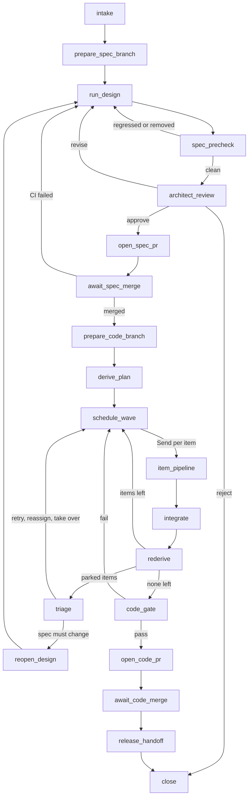
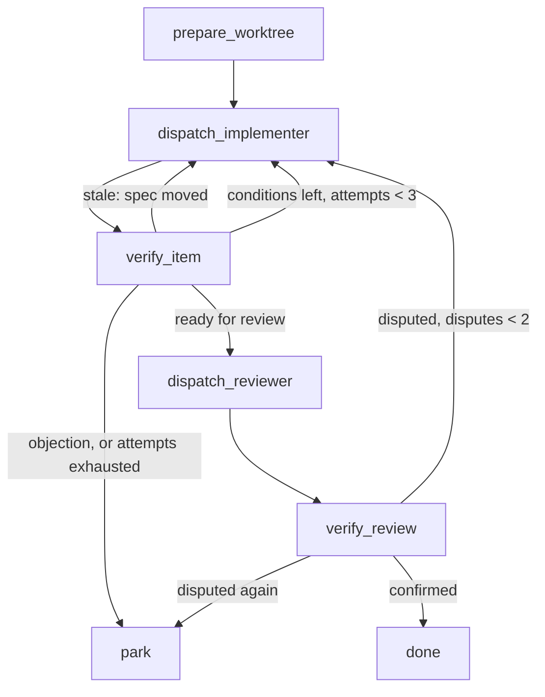

# Conseqa Delivery Loop Orchestrator Design

## 1. Status and purpose

**Status:** Design exploration. Nothing here is implemented, and nothing here is normative for Conseqa.  
**Baseline:** Conseqa `master`, commit `4def369`.  
**Depends on:** the Proposed Part I (`Conseqa_Spec_Change_Analysis_Revision_Specification.md`) and Part IV (`Conseqa_Conformance_and_Implementation_Guidance_Revision_Specification.md`), neither of which is built.

This document designs a concrete orchestrator for the delivery loop, the one drawn in the *Conseqa Delivery Loop* diagram. It is built with LangGraph, the proposed Conseqa tooling, and provider-agnostic coding agents (Claude Code, Codex, and any other agent that meets the contract in §7).

The point is not to build it yet. The point is to use it on paper, as a team adopting Conseqa would, and learn three things:

1. what the Conseqa tooling must guarantee for an orchestrator to drive it safely (§12, the main output);
2. what the loop feels like to the people in it (§9, §10);
3. whether the loop is feasible at a same-sprint cadence, and what to measure first (§13, §14).

---

## 2. What it is

The **loop service** is a LangGraph application. It turns a change request into merged, conformant code within a sprint. It dispatches coding agents for the labour and asks people only for the decisions that are theirs.

```text
                ┌────────────────────────── loop service (Python, LangGraph) ───────────────────────────┐
 people ──────► │  change graph (one thread per change)    item pipeline subgraph    signal intake graph │
 (CLI, PR       │  checkpointer: Postgres                  store: leases, board, main head             │
  reviews,      │  webhook receiver (git host)             job runner (detached agent processes)       │
  slash cmds)   └───────┬───────────────────────────┬───────────────────────────────┬──────────────────┘
                        │ subprocess, --json         │ launches                      │ branches, PRs,
                        ▼                            ▼                               ▼ webhooks
               conseqa CLI (Rust)          coding agents in worktrees         git host + CI
               diff, check, conform,       Claude Code, Codex, others         CI runs the same
               design; one                 each with a strict MCP config:     conseqa gates as
               conseqa-design-mcp          that worktree's server URL and     required checks
               serve per worktree          role token + the loop's own MCP
```

The loop service is a **separate repository and package**, outside the Conseqa repository. That keeps the two-binaries rule intact, and it forces the Conseqa tooling to be usable through its public surfaces alone (the CLI's JSON and the MCP tools). That is exactly the property an end-user setting needs.

---

## 3. Principles

1. **Conseqa is the state, the graph holds pointers.** The work list, conditions, conformance and obligation verdicts are derived from the files every time they are needed (Part IV §13.1). LangGraph state holds what routing needs: branch names, commit ids, item keys, attempt counts, job ids, decisions. It never holds a copy of architectural truth that could go stale.
2. **Trust the derivation, not the agent.** An agent's exit status and final message are telemetry. An item is done when re-deriving it shows its conditions cleared, never because the agent said so. This is the rule Conseqa's harness already follows: the final message is "never parsed to determine whether state changed" (`src/harness/backend.rs`).
3. **Every side effect is keyed and idempotent.** LangGraph re-runs a node from its start after a crash or an interrupt, so branch creation, PR creation, agent launches and attests must each be safe to repeat (§11).
4. **People decide meaning, agents do labour.** Interrupts exist at the points where meaning is decided: approving a spec change, settling an escalation, releasing. Everything else runs unattended.
5. **Provider-agnostic by contract.** Any agent that runs headless, speaks MCP with a strict configuration, and accepts a sandbox can fill any role (§7). Providers are chosen per role in configuration, and a reviewer comes from a different provider than the implementer it reviews.
6. **One change, one thread.** Concurrency between changes is handled by git, by Conseqa's refusal of stale work, and by declaration leases in the LangGraph store (§10). No graph coordinates another graph's internals.
7. **Least privilege per role.** A designer may change the spec. An implementer may change code and attest. A reviewer may only read and review. The credentials each agent receives enforce this (§12, T4).

---

## 4. Units of work

### 4.1 The change request

A change request (CR) is what a person files:

```yaml
id: cr-0142
title: Checkout traffic grows 10×
need: |
  Checkout traffic is forecast to grow tenfold before the holiday peak.
  Payments contend on serializable transactions, and shipping misses some
  payment.captured events under load.
requester: priya
architect: dan
sprint: 2026-S22
priority: high
```

`need` becomes the prompt of the design run. Conseqa records only the correctness obligations the run extracts (`intent/obligations.yaml`), not the prompt, so the loop keeps the CR as the record of what was asked.

### 4.2 Threads

Each CR is one LangGraph thread, `thread_id = cr-0142`, checkpointed in Postgres. A thread lives for the whole change, from intake to release hand-off, typically one to four days.

### 4.3 Branches

The loop uses a trunk-based, two-PR model by default. This matches the diagram, where the spec leads the code by hours:

| Branch | Holds | Merges into |
|---|---|---|
| `cr/0142/spec` | `.conseqa/spec/` and `.conseqa/intent/` changes only | `main`, through the spec PR |
| `cr/0142/code` | code, SQL, Terraform, and `.conseqa/conformance/` records | `main`, through the code PR |
| `cr/0142/item/<slug>` | one work item's edits, in its own worktree | `cr/0142/code`, merged by the loop |

Between the spec merge and the code merge, `main` is proven but not conformant for this change's obligations. That is allowed: `main`'s gate accepts a leading spec, and only the release gate demands conformance (Part IV §11.6, §15.3).

A **single-PR fast path** (spec and code together) is available per CR when the architect opts in. It is simpler for small changes, but it entangles spec review with code review and keeps other changes from seeing the new spec early.

---

## 5. The change graph



`architect_review`, `await_spec_merge`, `triage`, `await_code_merge` and `release_handoff` are the interrupt nodes.

### 5.1 Nodes

| Node | Does | Conseqa surface | Side effect key |
|---|---|---|---|
| `intake` | Validates the CR and registers it on the sprint board in the store. | none | CR id |
| `prepare_spec_branch` | Creates `cr/<id>/spec` from `main` in a worktree. | none | branch name |
| `run_design` | Runs the design workflow on the spec branch as a detached job, with the CR's need plus any review feedback as its prompt. | `conseqa design --prompt-file … --backend <designer>` (exists) | (CR, design attempt) |
| `spec_precheck` | Verifies the new spec, and diffs it against its merge base with `main`. Regressed or removed obligations loop back with the diff as feedback, unless the architect pre-approved removals. | `conseqa check --report`, `conseqa diff main --merge-base --report` (Part I) | none (read-only) |
| `architect_review` | **Interrupt.** Posts the diff's markdown rendering and waits for a decision (§9.1). | none | none |
| `open_spec_pr` | Pushes the branch and opens or updates the spec PR, posting the diff as a comment. | none | branch name; the PR is looked up before it is created |
| `await_spec_merge` | **Interrupt**, resumed by webhook: CI result, then merge. | CI runs `check` and `diff --fail-on regressed,removed` | none |
| `prepare_code_branch` | Creates `cr/<id>/code` from the spec merge commit, and records `spec_range = <spec base>..<spec merge>`. | none | branch name |
| `derive_plan` | Derives this CR's work items, scoped to its spec range. | `conseqa conform plan --spec-range … --json` (T2) | none |
| `schedule_wave` | Leases the items' declarations, picks a wave of items whose dependencies are done and whose files do not overlap, and fans them out. | uses the plan's `depends_on` and `files` (T3) | lease keys |
| `item_pipeline` | Subgraph: implement, verify, review, verify (§6). Ends `done` or `parked`; never interrupts. | `work_item`, `attest`, `record_review` | (item, attempt) |
| `integrate` | Merges finished item branches into the code branch in plan order, and dispatches a resolver agent on conflict. | none | merge commit per item |
| `rederive` | Merges `main` into the code branch if it moved, then re-derives the plan. Items can reappear here, stale or drifted after the merges. | `conform plan --spec-range … --json` | none |
| `triage` | **Interrupt**, once per wave, carrying every parked item (§9.2). | none | none |
| `reopen_design` | Turns an accepted objection into a follow-up spec change on the same CR: a new spec branch, design run and review. | none | (CR, design attempt) |
| `code_gate` | Checks that this CR's obligations are proven and conformant, and runs the project's own checks. | `conseqa conform check --spec-range … --fail-on not_conformant,disputed` (T2) | none |
| `open_code_pr`, `await_code_merge` | As for the spec PR. CI repeats the scoped gate and the tests. | same, in CI | branch name |
| `release_handoff` | **Interrupt** for the release owner. Holds the hooks for Parts II, III and V (§8.3). | `conseqa conform check` unscoped, on the release candidate | none |
| `close` | Releases leases, updates the board, writes the run report. | none | CR id |

### 5.2 State

A sketch, not code:

```python
class ItemRun(TypedDict):
    key: str                       # textual declaration key = work item id (Part IV §11.2)
    status: Literal["queued", "blocked", "running", "verifying", "reviewing", "done", "parked"]
    attempt: int
    disputes: int
    implementer: str               # provider id
    reviewer: str | None
    job_id: str | None
    branch: str | None
    conditions: list[str]          # from the last derivation
    feedback: list[str]            # what the next attempt is told
    park_reason: str | None

class ChangeState(TypedDict):
    cr: ChangeRequest
    phase: str
    spec_branch: str
    code_branch: str
    spec_range: str | None         # "<spec base>..<spec merge>"
    design_attempts: int
    diff_ref: str | None           # blob id of the Part I diff document, never its content
    spec_pr: int | None
    code_pr: int | None
    items: Annotated[dict[str, ItemRun], merge_by_key]
    gates: Annotated[list[GateResult], operator.add]
    decisions: Annotated[list[HumanDecision], operator.add]
    spend: Annotated[Spend, add_spend]
```

Parallel `Send` branches update different item keys, so `items` needs a reducer that merges by key. Everything architectural (conditions, obligations, the packet) is re-derived when needed. The state keeps the last derivation's conditions only so it can route and report.

---

## 6. The item pipeline



### 6.1 `dispatch_implementer`

1. **Idempotent launch.** The job record is keyed by `(thread, item, attempt)` and written to the store before launch. A re-run of the node after a crash finds the job and awaits it instead of launching another.
2. **Credentials.** Mints an implementer token for this item (T4). The token's claims carry the provider, model and job id, which Conseqa stamps into the record's `by` (T5).
3. **MCP configuration.** Writes a strict configuration with exactly two servers:
   - the worktree's design MCP server. The loop itself starts `conseqa-design-mcp serve --project <worktree>` over HTTP, and hands the agent its URL and the implementer token in an environment variable, as Conseqa's harness does for design tasks. The server runs as the loop's process, so no agent sandbox constrains it;
   - the loop's own MCP server (§7.4).
4. **Launch.** Starts the agent through its adapter, with the workspace-write sandbox, a wall-clock and turn budget, and the implementer instructions (§7.3).
5. **Await.** Blocks on the job asynchronously, and records usage into `spend`.

### 6.2 `verify_item`

Re-derives the item in the worktree (`conseqa conform item <key> --json`), runs the project's configured checks, and routes:

| Finding | Route |
|---|---|
| `attest` was refused as stale, or the item's residual moved | retry. The next packet carries the delta, so no feedback is needed. |
| `missing_facts`, `incomplete`, `drifted` or scan errors remain | retry, with those conditions as feedback |
| project checks failed | retry, with the failing output as feedback |
| the agent raised an objection (§7.4) | park |
| attempts reached the limit (default 3) | park |
| only `unreviewed` remains, or nothing remains | review |

### 6.3 `dispatch_reviewer` and `verify_review`

The reviewer runs from the item's branch with a reviewer token, a read-only sandbox, and a provider different from the implementer's. It reads the packet, the record and the files, and calls `record_review`. The worktree's design MCP server, which the loop started, writes the review into the record, so the reviewer needs no write access to the repository. The loop then commits the record change on the item branch.

`verify_review` re-derives the item:

- **Confirmed at current digests:** done.
- **Disputed:** the dispute notes go back to the implementer as feedback (T7).
- **A second dispute:** park.

### 6.4 Why the pipeline never interrupts

An interrupt inside one fanned-out branch would hold every other item in the wave at the join until a person answered. Instead, a stuck item ends `parked`, the wave finishes, and `triage` asks once about every parked item together. People get one batched question per wave, and the agents keep working meanwhile.

---

## 7. Agents, provider-agnostically

### 7.1 The contract an agent must meet

| Requirement | Why |
|---|---|
| Runs headless from a prompt, in a given working directory | No terminal, no person attached. |
| Connects to MCP servers given at launch, and ignores the user's own (strict configuration) | Conseqa and the loop are reached only through their tools, and an agent's personal servers stay out of the work. |
| Honours a sandbox: read-only or workspace-write | Implementers write their worktree only; reviewers write nothing. |
| Can be killed, and honours a turn or time budget | Runaway sessions end. |
| Emits a machine-readable event stream (optional) | Telemetry and cost; never authority. |

Claude Code and Codex meet all five today. Conseqa's harness already launches both this way for design tasks (`src/harness/backends/claude.rs`, `codex.rs`), with a read-only sandbox and the token in an environment variable. The loop's adapters are the same shape with different sandboxes.

### 7.2 Adapters

```python
class AgentTask(TypedDict):
    role: Literal["implementer", "reviewer", "resolver"]
    provider: str                # "claude-code", "codex", "gemini-cli", ...
    workdir: str
    instructions: str
    mcp_servers: list[McpServer] # conseqa (with role token) + loop
    sandbox: Literal["read_only", "workspace_write"]
    budget: Budget               # wall time, turns, spend ceiling

class AgentAdapter(Protocol):
    def launch(self, task: AgentTask, job_id: str) -> JobHandle: ...
    def await_(self, handle: JobHandle) -> AgentRun: ...   # status, session, usage, transcript path
    def cancel(self, handle: JobHandle) -> None: ...
```

| Provider | Launch, as the harness does it today | Sandbox per role |
|---|---|---|
| Claude Code | `claude -p <instructions> --output-format stream-json --verbose --mcp-config <file> --strict-mcp-config --max-turns N` | implementer: a permission mode that accepts edits in the worktree; reviewer: read tools only |
| Codex | `codex exec --json --ephemeral --sandbox <mode> -c mcp_servers.conseqa.url=… -c mcp_servers.conseqa.bearer_token_env_var=…` | `workspace-write` or `read-only` |
| Others (Gemini CLI, OpenCode, …) | the same contract through their own flags | the same |

Jobs run detached from the graph process: a local process pool on one machine, or containers on a cluster. The graph node only launches and awaits, so restarting the loop service neither kills nor duplicates a running agent.

### 7.3 Instructions

Instructions are short, stable, and role-specific. They never paste the packet: the agent fetches it with `work_item`. The packet is then always fresh, the prompt stays small, and every provider gets identical text. The implementer's instructions, in full:

> You are implementing one work item in this repository: `transaction operation.apply_payment/tx.apply_payment`.
> 1. Call `work_item` with that key. It tells you what to change, where, which facts are load-bearing and why, and how this project already does it.
> 2. Change code only inside `conseqa:begin`/`conseqa:end` markers for this declaration, adding markers where the packet says the code belongs.
> 3. Run the checks the packet lists.
> 4. Call `attest` with the required facts and the lines that provide each one. If attest is refused because the spec moved, call `work_item` again and continue from the new packet.
> 5. If the spec cannot be implemented as written, call `raise_objection` and stop. Do not change anything under `.conseqa/spec/`.

### 7.4 The loop's own MCP server

A tiny server the loop exposes to every agent it launches:

| Tool | Effect |
|---|---|
| `raise_objection(kind, detail)` | `kind` is `spec_infeasible`, `out_of_scope` or `needs_human`. Parks the item with the detail (§6.2). |
| `report_progress(note)` | Appends a note to the item's run, shown in `loop status`. |

Because these go over MCP, they work the same for every provider. They are the agent's only channel back to people, and they are deliberately narrow.

### 7.5 Roles to providers

From the loop's configuration (§8.1):

| Role | Default | Rule |
|---|---|---|
| designer | `conseqa design --backend claude` | the existing harness runs the design |
| implementer | Claude Code or Codex, alternating by item | none |
| reviewer | the other provider | never the item's implementer provider |
| resolver | Claude Code | merge conflicts only; its result is re-derived like any other |

---

## 8. Configuration and policy

### 8.1 The loop's configuration

Committed in the repository the loop serves:

```yaml
# .github/conseqa-loop.yaml
providers:
  claude-code: { model: claude-opus-5-5, max_turns: 80 }
  codex:       { model: gpt-5.x-codex }
roles:
  designer:    { backend: claude }
  implementer: { providers: [claude-code, codex], assign: alternate }
  reviewer:    { distinct_from: implementer }
concurrency: { items_per_wave: 4, agents_total: 8 }
budgets:     { attempts: 3, disputes: 2, per_cr_usd: 150 }
checks:                       # what "the project's checks" means in §6.2
  - cargo test --workspace
  - cargo clippy -- -D warnings
approvals:
  spec: [architect]           # who may resume architect_review
  release: [release-owner]
merge: { spec: on_approval_and_green, code: on_green }
```

### 8.2 Conseqa's own policy

The loop does not override Conseqa's policy (`.conseqa/conformance/policy.yaml`, Part IV §14.4). It reads it to know which reviews are required.

### 8.3 Release hooks

`release_handoff` runs the unscoped `conseqa conform check --fail-on not_conformant,disputed` on the release candidate, and asks the release owner. It is the place where the later parts plug in:

- **Part II:** tag the deployed commit as the baseline;
- **Part III:** turn migration steps into ordered items and deploy steps;
- **Part V:** run the transition check before the rollout.

---

## 9. People in the loop

### 9.1 Approving a spec change

| | |
|---|---|
| **Who** | The CR's architect, or anyone listed under `approvals.spec`. |
| **Where** | The spec PR, where the loop posts the Part I diff as markdown. Approving the PR resumes the thread through the webhook. `loop approve cr-0142` does the same from a terminal. |
| **Sees** | The declaration changes; every rebased, regressed, improved, added or removed obligation, with why; the reliance delta; the design run's notes. |
| **Answers** | **approve**; **revise** (the review text becomes design feedback, and `run_design` runs again); or **reject** (the CR closes). |

This is the one decision every CR needs. Its speed depends on how readable the obligation diff is, which is why Part I comes first.

### 9.2 Triage of parked items

| | |
|---|---|
| **Who** | The architect or tech lead. |
| **Where** | One comment per wave on the code PR, or `loop triage cr-0142`, answered with slash commands. |
| **Sees** | Per item: attempts, remaining conditions, test failures, dispute notes, the objection if any, and the transcript links. |
| **Answers** | `/loop retry <item> "<guidance>"`; `/loop reassign <item> codex`; `/loop takeover <item>` (a person pushes to the item branch, and the loop re-derives when they say done); or `/loop redesign <item> "<objection accepted: …>"`, which goes to `reopen_design`. |

### 9.3 Release

The release owner sees every proven obligation and whether it is conformant, plus, once Parts II, III and V exist, the migration plan and the transition verdict.

### 9.4 Everything else is unattended

Design runs, gates, planning, implementation, review, integration and the code PR all run without a person, unless budgets run out or a gate fails twice. Someone watching sees `loop board`:

```text
SPRINT 2026-S22                          phase           items   obligations
cr-0142  Checkout traffic grows 10×      implementing    3/5     12 proven, 9 conformant
cr-0143  Refunds                         spec review     -       waiting on dan
cr-0145  Re-key storage                  intake          -       -
```

---

## 10. Changes running side by side

### 10.1 Leases

Before a wave, `schedule_wave` leases each item's declaration key in the store (`("leases", key) → cr`). If another CR holds the lease, the item is `blocked` and the wave skips it. When the holder's code PR merges, the lease is released, and the blocked CR's next `rederive` merges `main` and sees whatever of the item is still its own to do. Leases prevent two agents from implementing one declaration at once. They are an efficiency measure, not a safety one.

### 10.2 Conseqa's refusal is the safety net

If the spec moves under an item anyway, Part IV's attest refuses the stale work. That happens when `rederive` merges `main` while an agent is still running, or when a person pushes to the spec branch. The agent fetches a fresh packet, so nothing is recorded against a spec that has moved.

### 10.3 Spec changes that collide

Two CRs whose spec branches touch the same entity file conflict in git. Spec files are one per entity (`PROJECT_STATE.md`), so conflicts are rare and local. The later spec PR merges `main` and re-runs `spec_precheck`. If the diff changed, the architect approves again: the meaning moved, so the approval must too.

### 10.4 How the loop hears about `main`

The webhook receiver records `main`'s head in the store on every push. Threads read it only at sync points (`rederive`, `code_gate`), never mid-item. This keeps busy repositories from making agents thrash on rebases.

---

## 11. Failure and recovery

| Failure | Handling |
|---|---|
| The loop service crashes | Postgres checkpoints with `durability="sync"` on side-effecting nodes. On restart, interrupted nodes re-run from their start. Every side effect is keyed (§5.1), and agent jobs are found by key rather than relaunched. |
| An agent hangs | Its wall budget kills it; `verify_item` sees the conditions unchanged and retries with "previous attempt timed out". |
| An agent edits outside its regions | Other declarations show `drifted`. Completeness claims flag new writes to modelled objects (Part IV §9). The reviewer sees the full diff of the item branch. Drifted declarations reappear as items at `rederive`. |
| An agent edits the spec | The implementer token cannot call `submit_patch`. A code-PR CI rule refuses any change under `.conseqa/spec/` (T10). |
| An agent fakes evidence | Attest computes digests itself (Part IV §14.2), and the reviewer, from another provider, checks the evidence lines. |
| Review collusion: two models agree on something wrong | Sampled human review of confirmed records, in the run report. Deterministic checkers later (Part IV §21). |
| Merge conflicts between items | Waves avoid overlapping files (T3). A resolver handles the rest, and every resolved region is re-derived. |
| CI is slow or flaky | Interrupts wait on webhooks rather than holding a process; a `RetryPolicy` covers transient git and host errors only. |
| Spend overruns | `spend` accumulates per CR. Crossing the budget parks every running item for `triage`. |
| A thread grows long | One CR stays well under LangGraph's default recursion limit of 1000 steps. The board is a store namespace, not a thread, so the sprint never accumulates steps. |

---

## 12. What this asks of the tooling

The main result of the exercise. Each property is something the orchestrator needs in order to drive Conseqa safely without a person reading its output. Status says whether Parts I and IV already provide it.

| # | Property | Why the loop needs it | Status |
|---|---|---|---|
| T1 | Every command the loop calls has a documented, versioned JSON output: `diff`, `check`, and every `conform` subcommand. | The loop routes on fields, never on text. | Part I §14 has a versioned diff document. Part IV §15.2 lists `--json` without a schema or format counter: **gap**. |
| T2 | `conform plan` and `conform check` accept an explicit spec range (`--spec-range <a>..<b>`) and scope to the obligations and declarations that range changed. | In a trunk-based flow, `main` carries other changes' leading specs. Part IV's `--base` scopes against the working tree, so it sweeps in their items, and a CR's gate would fail on another CR's work. | **Gap** (Part IV §11.5). |
| T3 | The plan's JSON gives each item `depends_on` (item keys) and `files` (the paths of its regions and likely regions). | The scheduler builds parallel waves that do not collide. | Part IV §11.4 orders items but exposes neither: **gap**. |
| T4 | The design MCP server has an **implementer** role (`work_item`, `attest`, read tools) and a **reviewer** role (`work_item`, `record_review`, read tools), and neither gets `submit_patch` or `build_design`. | Least privilege. Part IV gives `attest` to the coordinator role, which can also patch the spec. | **Gap** (Part IV §15.1). |
| T5 | `by` on attests and reviews is stamped from the credential's claims (provider, model, job id), never supplied by the agent. | Makes "the reviewer differs from the attester" checkable rather than claimed, and lets run reports trace every record to a job. | Part IV §14.5 records a self-declared `by`: **gap**. |
| T6 | Repeating an identical attest or review is a no-op success. | Retries after a crash replay calls. Part IV's optimistic replace would refuse the replay as "changed". | **Gap** (Part IV §8.4). |
| T7 | The work item packet includes open review disputes, and the reason the last attest was refused. | The implementer's retry must see why the last attempt failed without the loop pasting it into a prompt. | **Gap** (Part IV §12.1). |
| T8 | Derivation is cheap to repeat: status and plan are cached by (spec digest, scanned-files digest, records digest), and load-bearing checks by (model digest, fact). | The loop re-derives at every routing step, for several CRs at once. | Not addressed: **gap** (performance). |
| T9 | Markdown renderings for posting to PRs: `diff --format markdown`, `conform status --format markdown`. | The spec review happens in the PR, and its readability sets the loop's pace. | Part I has text and JSON: **gap** (ergonomics). |
| T10 | A cheap check that a PR touches only spec files, or only code and records. | Keeps spec review and code review separate, and stops agents from editing the spec. | Small. Could be a `conseqa diff` summary field, or a CI rule in the loop. |
| T11 | Placement hints for declarations with no code yet: where this project puts new transactions, effects and runtime definitions. | On a fresh or unbound codebase, precedents do not exist yet (Part IV §12.3). | **Gap**. Could live in Part IV's policy file. |
| T12 | A bootstrap mode: bind and attest existing code with no behaviour change. | A team adopting Conseqa starts with every declaration unbound. That first pass is the largest and most valuable CR. | Works with Part IV as written, but would benefit from T3 and T11. |
| T13 | Stable exit codes: 0 done, 1 could not derive, 2 gate failed. | The loop and CI agree on meaning. | Specified (Part I §15.3, Part IV §15.3). |
| T14 | Per-worktree independence: one `conseqa-design-mcp serve --project <worktree>` per worktree, minting role tokens the loop requests, and attest beside an open server. | Parallel items run in parallel worktrees, each with its own server. | The per-checkout lock and attest beside a server are specified (Part IV §15.2). Minting tokens per role on request is part of T4. |
| T15 | The design workflow accepts feedback rounds on an existing spec. | `architect_review → revise → run_design`. | Exists: each `conseqa design` run takes a new prompt, and the loop appends the feedback. |

T1–T7 are small amendments to Parts I and IV and should be made before either is built. T8 is a performance requirement to keep in mind while building. T9–T12 are ergonomics and can follow.

---

## 13. Feasibility

### 13.1 What could run today

Intake, design (`conseqa design`), the `conseqa check` gate, architect review and PR choreography need nothing new. A loop MVP covering steps 1–3 of the diagram could be built now, with the architect reading YAML diffs instead of the obligation diff.

### 13.2 What waits on the tooling

- Meaningful spec review waits on Part I.
- Everything after the spec merge waits on Part IV and on T1–T7.

### 13.3 The hard parts

1. **Agent discipline with markers and evidence.** Whether agents place regions correctly, cite the right lines, and stay inside scope decides the retry rate. It must be measured (§14, S2).
2. **Review quality.** Two models can agree on something wrong. Planted-defect trials (S3) and sampled human review are the defence until deterministic checkers exist.
3. **Brownfield bootstrap.** Adopting Conseqa on an existing codebase starts with every declaration unbound. The bootstrap CR (T12) is the first real workload, and the largest.
4. **Latency at a same-sprint cadence.** A rough budget for a ten-item change, with four parallel agents:

   | Step | Duration |
   |---|---|
   | design run | 20–60 min |
   | architect review | minutes to hours, depending on the person |
   | three waves, each one implementation plus one review | 45–90 min per wave |
   | integration and CI | 30 min |
   | **total** | about one working day |

   That fits a sprint with room for retries. The figures are guesses to be replaced by S1 and S2.
5. **Human bandwidth.** The architect's approval is the only mandatory human step per CR, so its speed bounds throughput. Triage is the second, and depends on the park rate.
6. **Cost.** Per CR, roughly items × (attempts × implementer run + reviewer run) + design run. The attempt rate dominates, and it is unknown until S2.
7. **Churn on `main`.** Many concurrent CRs mean more syncs and more stale refusals. Leases and sync-only-at-checkpoints bound the waste. If refusals stay high, smaller CRs are the fix, not more machinery.

### 13.4 Verdict

The loop is feasible in shape, and the graph and agent contract are ordinary. Everything that makes it trustworthy lives in Conseqa's derivations: re-derivation as the source of truth, refusals of stale work, tool-computed digests, independent review. The two unknowns that decide whether it is economical are the agents' retry rate on marked, attested work, and the reliability of cross-provider review. Both can be measured before Part IV is built.

---

## 14. Spikes before building the tooling

| Spike | What it builds | What it answers |
|---|---|---|
| S1 Wizard of Oz | The change graph and item pipeline in LangGraph, with every `conseqa diff`/`conform` call answered from hand-written JSON fixtures in the documented formats. | Whether the graph, interrupts, triage batching and PR choreography feel right. Which JSON fields the loop actually needs, which confirms or trims T1–T3. |
| S2 Marker discipline | A fixture repository and hand-written packets for five realistic items, given to Claude Code and Codex with the §7.3 instructions, and a fake `attest` that records what it is sent. | Region placement accuracy, evidence accuracy, scope creep, and attempts per item. This is the retry rate in §13.3. |
| S3 Review independence | The S2 results with planted defects (a dropped version comparison, a missing redrive policy), reviewed by the other provider. | How often a reviewer disputes a real defect, and how often it disputes a correct one. |
| S4 Review time | Five realistic spec changes, reviewed once as raw YAML diffs and once as hand-written Part I diffs. | Whether the obligation diff shortens the one mandatory human step, and by how much. |

S1 and S2 can run this week, because neither needs Part I or Part IV to exist.

---

## 15. Open questions

1. Two-PR trunk flow by default, or one PR per change?
2. Should the loop live in its own repository (recommended, §2), or in a `loop/` directory of the Conseqa repository? Both keep the two-binaries rule, since the loop is Python.
3. A self-hosted LangGraph process, or a hosted LangGraph deployment?
4. May the requester approve spec changes, or only the architect?
5. Should the loop merge on green automatically, as the default configuration does for code, or always wait for a person?
6. Should T1–T7 be folded into Parts I and IV now, before either is built?
